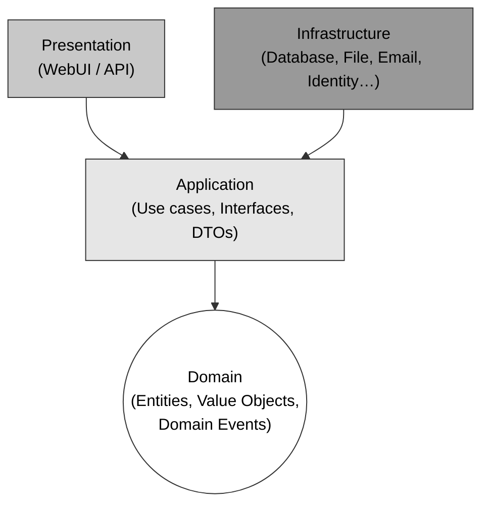
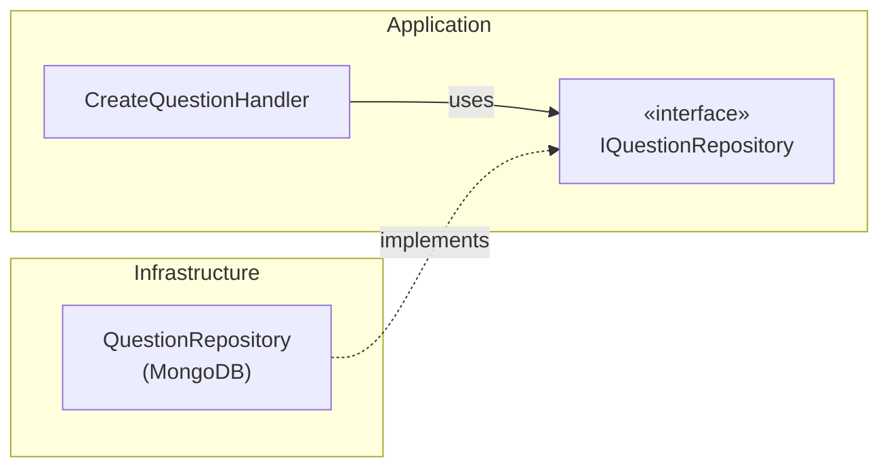
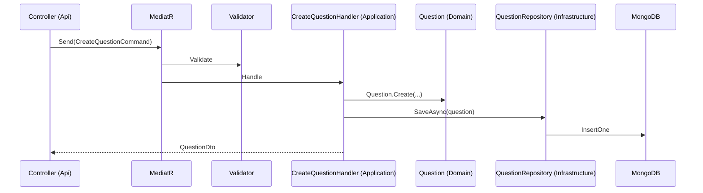

# Clean Architecture

> Tài liệu tổng hợp từ bài giảng *#9: Clean Architecture* (TEDU).
> Liên quan: [Tactical Domain Driven Design.md](Tactical%20Domain%20Driven%20Design.md) · [Use Case & Domain Model.md](Use%20Case%20%26%20Domain%20Model.md) · [MongoDB Introduction.md](MongoDB%20Introduction.md)

## Mục lục

1. [Mô hình Clean Architecture](#1-mô-hình-clean-architecture)
2. [Dependency Rule](#2-dependency-rule)
3. [Vai trò từng layer](#3-vai-trò-từng-layer)
4. [Cấu trúc thư mục](#4-cấu-trúc-thư-mục)
5. [Ưu điểm](#5-ưu-điểm)
6. [Công nghệ sử dụng](#6-công-nghệ-sử-dụng)
7. [Áp dụng vào Quiz Project](#7-áp-dụng-vào-quiz-project)
8. [Tài liệu tham khảo](#8-tài-liệu-tham-khảo)

---

## 1. Mô hình Clean Architecture

Clean Architecture tổ chức hệ thống thành các **vòng tròn đồng tâm**. **Domain** nằm ở trung tâm, bao quanh là **Application**, ngoài cùng là **Presentation** và **Infrastructure**.



**Domain** và **Application** hợp thành **Core** của hệ thống.

## 2. Dependency Rule

> **Các phụ thuộc chỉ được hướng vào trong.** Layer bên trong không được biết gì về layer bên ngoài.

| Layer | Được phép tham chiếu tới |
|---|---|
| Domain | Không phụ thuộc layer nào |
| Application | Domain |
| Infrastructure | Application (và gián tiếp Domain) |
| Presentation | Application (Infrastructure chỉ dùng để đăng ký DI lúc khởi động) |

Làm sao để Application truy cập database mà không phụ thuộc Infrastructure? Dùng **Dependency Inversion**:

- **Application** khai báo interface, ví dụ `IQuestionRepository`.
- **Infrastructure** hiện thực interface đó, ví dụ `QuestionRepository` dùng MongoDB.
- **Presentation** đăng ký implementation vào DI container khi khởi động.



## 3. Vai trò từng layer

| Layer | Chứa gì | Không được chứa |
|---|---|---|
| **Domain** | Entities, Value Objects, Aggregates, Domain Events, Enums, Exceptions, business rules | Code truy cập DB, framework, UI |
| **Application** | Use cases (Commands/Queries, Handlers), interfaces (Repository, Services), DTOs, Validators, Mapping | Implementation cụ thể của DB, email, file… |
| **Infrastructure** | Implementation của interface: DB access (EF Core, MongoDB), Identity, File storage, Email, gọi API bên ngoài | Business logic |
| **Presentation** | Controllers / Pages / Components (WebUI, Web API), cấu hình, middleware | Business logic, truy cập DB trực tiếp |

> Đối chiếu với mô hình gốc của Uncle Bob: **Entities** ≈ Domain, **Use Cases** ≈ Application, **Interface Adapters** và **Frameworks & Drivers** ≈ Presentation + Infrastructure.

## 4. Cấu trúc thư mục

Ví dụ solution **Northwind** (template của Jason Taylor):

```text
Northwind/
├── src/
│   ├── Application/
│   ├── Domain/
│   ├── Infrastructure/
│   └── WebUI/
└── tests/
    ├── Application.UnitTests/
    ├── Domain.UnitTests/
    ├── Infrastructure.IntegrationTests/
    └── WebUI.IntegrationTests/
```

- Mỗi layer là một **project riêng** (`.csproj`). Nhờ đó trình biên dịch tự ngăn tham chiếu sai chiều.
- Có thể **unit test** Domain và Application (không cần DB thật).
- Infrastructure và WebUI được kiểm thử bằng **integration test**.

## 5. Ưu điểm

| Ưu điểm | Giải thích |
|---|---|
| **Independent of frameworks** | Không bắt buộc phải có một tool hay framework cụ thể |
| **Testable** | Core không phụ thuộc thứ gì bên ngoài nên viết test tự động dễ hơn nhiều |
| **Independent of UI** | Logic tách khỏi UI nên dễ đổi công nghệ: hôm nay Angular, mai Vue, sau này Blazor |
| **Independent of the database** | Phần truy cập dữ liệu được tách riêng, chuyển từ SQL Server sang CosmosDB (hay DB khác) rất đơn giản |
| **Independent of anything external** | Core hoàn toàn cô lập với thế giới bên ngoài. Đây là khác biệt giữa hệ thống sống được 3 năm và hệ thống sống được 20 năm |

## 6. Công nghệ sử dụng

| Công nghệ | Vai trò | Layer |
|---|---|---|
| **.NET 5** | Nền tảng | Tất cả |
| **Entity Framework Core 5** | ORM truy cập database quan hệ | Infrastructure |
| **Blazor** | Xây dựng UI bằng C# | Presentation |
| **MediatR** | Hiện thực Mediator pattern, dùng cho CQRS (Command/Query + Handler) | Application |
| **AutoMapper** | Map giữa Entity và DTO | Application |
| **FluentValidation** | Validate Command/Query | Application |
| **xUnit** | Framework unit test | tests |
| **Docker** | Đóng gói, triển khai | Deployment |

> **Lưu ý:**
> - .NET 5 đã hết hỗ trợ từ tháng 5/2022. Máy bạn đang có **.NET 10 SDK**, nên dùng .NET 10 (bản LTS).
> - Quiz Project dùng **MongoDB** nên Infrastructure sẽ dùng **MongoDB.Driver** thay cho EF Core.
> - **MediatR** và **AutoMapper** đã chuyển sang giấy phép thương mại cho các bản mới (từ 2025). Khi dùng cho dự án học tập cần kiểm tra lại điều khoản, hoặc dùng bản cũ hay thư viện thay thế.

## 7. Áp dụng vào Quiz Project

> Phần này là gợi ý áp dụng, không có trong slide gốc.

Áp dụng cho **ADMIN REST API** (WBS 5.5: *Implement RESTAPI with DDD for Admin*):

```text
Quiz.Admin/
├── src/
│   ├── Quiz.Admin.Domain/            ← Aggregates: Question, Exam, Category, ExamResult
│   ├── Quiz.Admin.Application/       ← Commands/Queries (MediatR), DTOs, IRepository, Validators
│   ├── Quiz.Admin.Infrastructure/    ← MongoDB repositories, Identity client
│   └── Quiz.Admin.Api/               ← Controllers, Swagger, API Versioning
└── tests/
    ├── Quiz.Admin.Domain.UnitTests/
    └── Quiz.Admin.Application.UnitTests/
```

Luồng xử lý một request, ví dụ **tạo câu hỏi**:



Lệnh tạo solution và thiết lập tham chiếu đúng chiều:

```powershell
dotnet new sln -n Quiz.Admin
dotnet new classlib -n Quiz.Admin.Domain -o src/Quiz.Admin.Domain
dotnet new classlib -n Quiz.Admin.Application -o src/Quiz.Admin.Application
dotnet new classlib -n Quiz.Admin.Infrastructure -o src/Quiz.Admin.Infrastructure
dotnet new webapi -n Quiz.Admin.Api -o src/Quiz.Admin.Api
dotnet sln add (Get-ChildItem -Recurse -Filter *.csproj)

dotnet add src/Quiz.Admin.Application reference src/Quiz.Admin.Domain
dotnet add src/Quiz.Admin.Infrastructure reference src/Quiz.Admin.Application
dotnet add src/Quiz.Admin.Api reference src/Quiz.Admin.Application src/Quiz.Admin.Infrastructure
```

## 8. Tài liệu tham khảo

- Clean Architecture with .NET Core: Getting Started – Jason Taylor
- https://github.com/jasontaylordev/CleanArchitecture
- https://blog.cleancoder.com/uncle-bob/2012/08/13/the-clean-architecture.html
