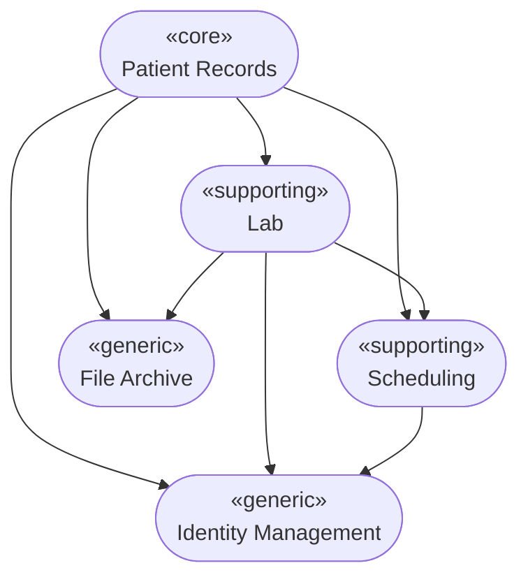
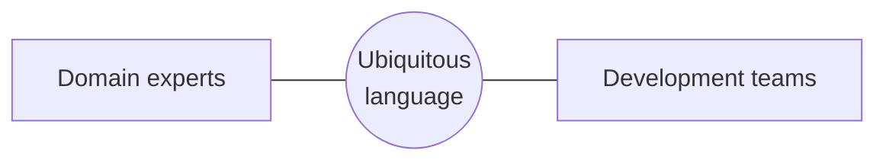
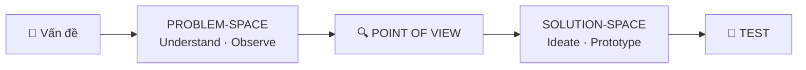
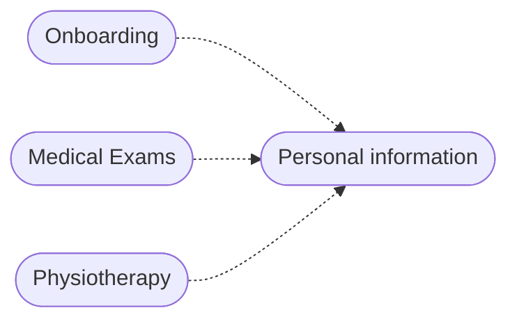
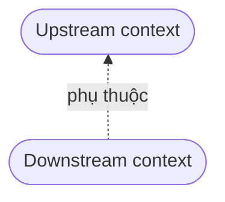
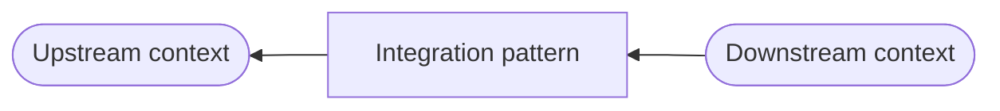
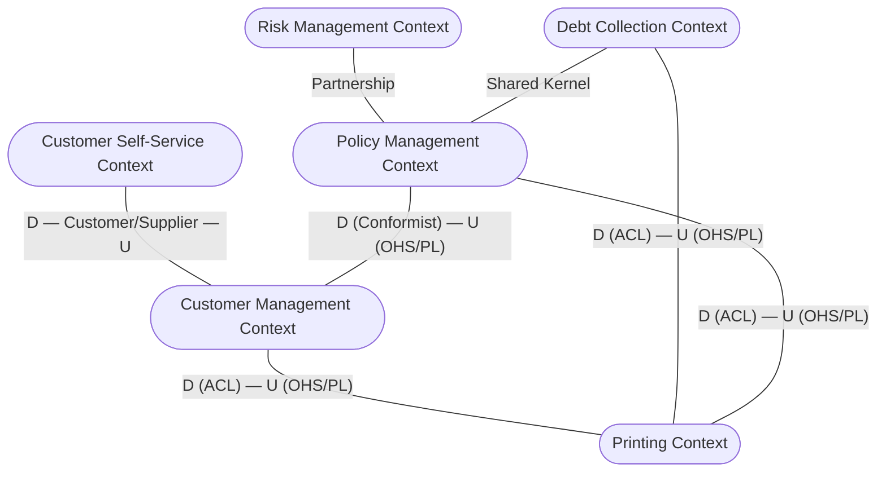

# Domain-Driven Design (DDD)

> Tài liệu tổng hợp kiến thức về Domain-Driven Design, hệ thống hóa từ slide bài giảng.

## Mục lục

1. [Giới thiệu](#1-giới-thiệu)
2. [DDD là gì?](#2-ddd-là-gì)
3. [Ưu điểm của DDD](#3-ưu-điểm-của-ddd)
4. [Tổng quan: Concepts & Building Blocks](#4-tổng-quan-concepts--building-blocks)
5. [Domain](#5-domain)
6. [Subdomains](#6-subdomains)
7. [Ubiquitous Language](#7-ubiquitous-language)
8. [Problem to Solution](#8-problem-to-solution)
9. [Bounded Context](#9-bounded-context)
10. [Relationships Between Contexts](#10-relationships-between-contexts)
11. [Context Map & Integration Patterns](#11-context-map--integration-patterns)
12. [Building Blocks](#12-building-blocks)
13. [Bản đồ tổng thể DDD](#13-bản-đồ-tổng-thể-ddd)
14. [Áp dụng vào Quiz Project](#14-áp-dụng-vào-quiz-project)
15. [Tài liệu tham khảo](#15-tài-liệu-tham-khảo)

---

## 1. Giới thiệu

- DDD xuất hiện từ khi **Eric Evans** xuất bản cuốn sách về chủ đề này vào năm **2003**.
- Hai cuốn sách nền tảng:
  - *Domain-Driven Design: Tackling Complexity in the Heart of Software* (Eric Evans)
  - *Implementing Domain-Driven Design* (Vaughn Vernon)

## 2. DDD là gì?

- Tập trung vào **core domain** (miền nghiệp vụ cốt lõi) và **domain logic** (logic nghiệp vụ).
- Xây dựng các thiết kế phức tạp dựa trên **mô hình của domain** (domain model).
- **Liên tục cộng tác với domain experts** (chuyên gia nghiệp vụ) để cải thiện mô hình ứng dụng và giải quyết các vấn đề nghiệp vụ phát sinh.

## 3. Ưu điểm của DDD

| Ưu điểm | Ý nghĩa |
|---|---|
| **Eases Communication** – Dễ giao tiếp | Dev và domain expert dùng chung một ngôn ngữ |
| **Improves Flexibility** – Tăng tính linh hoạt | Mô hình được chia nhỏ, dễ thay đổi, mở rộng |
| **Emphasizes Domain Over Interface** – Ưu tiên domain hơn giao diện | Thiết kế xoay quanh nghiệp vụ, không xoay quanh UI hay công nghệ |

## 4. Tổng quan: Concepts & Building Blocks

DDD gồm hai nhóm kiến thức chính:

| Strategic Design (Concepts) | Tactical Design (Building Blocks) |
|---|---|
| Domain | Entity |
| Subdomains | Value Object |
| The Ubiquitous Language | Domain Event |
| Bounded Context | Aggregate |
| Relationships Between Contexts | Service |
| Context Map | Repository |
|  | Factory |

- **Strategic design**: phân tích, chia tách bài toán ở mức tổng thể (*làm gì, chia ranh giới ở đâu*).
- **Tactical design**: các mẫu thiết kế để hiện thực mô hình trong code (*code như thế nào*).

## 5. Domain

- Định nghĩa từ điển: **"A sphere of knowledge or activity"**, tức một lĩnh vực kiến thức hoặc hoạt động.
- Trong kỹ thuật phần mềm, domain là **lĩnh vực nghiệp vụ mà ứng dụng hướng đến giải quyết**.

## 6. Subdomains

- Domain là khái niệm rất rộng và trừu tượng.
- Để cụ thể hơn, ta chia domain thành các phần nhỏ gọi là **subdomains**.
- Mọi subdomain đều thuộc một trong ba loại:

| Loại | Mô tả | Chiến lược đầu tư |
|---|---|---|
| **Core domain** | Phần cốt lõi, tạo nên giá trị và lợi thế cạnh tranh của hệ thống | Đầu tư nhiều nhất, team giỏi nhất |
| **Supporting subdomain** | Hỗ trợ core domain, đặc thù cho doanh nghiệp nhưng không phải lợi thế cạnh tranh | Tự làm ở mức vừa đủ |
| **Generic subdomain** | Bài toán chung, nhiều hệ thống đều có (auth, lưu file…) | Dùng giải pháp có sẵn / mua ngoài |

### Ví dụ: Hệ thống EMR (Electronic Medical Records) cho phòng khám nhỏ

- **Patient Records** *(core)*: quản lý hồ sơ bệnh án (thông tin cá nhân, tiền sử bệnh…).
- **Lab** *(supporting)*: đặt xét nghiệm và quản lý kết quả xét nghiệm.
- **Scheduling** *(supporting)*: đặt lịch hẹn.
- **File Archive** *(generic)*: lưu trữ và quản lý file đính kèm hồ sơ (tài liệu, ảnh X-quang, giấy tờ scan).
- **Identity Management** *(generic)*: đảm bảo đúng người truy cập đúng thông tin.



## 7. Ubiquitous Language

### 7.1. Vấn đề

- Lập trình viên nói bằng **thuật ngữ kỹ thuật** (design pattern, viết tắt, "joke" nội bộ).
- Domain expert dùng **thuật ngữ chuyên ngành** của lĩnh vực họ.
- Máy tính "nói" bằng ngôn ngữ lập trình.
- → *Something's gotta give!* Cần một ngôn ngữ chung.



### 7.2. Định nghĩa

- **Ubiquitous** (adj.): hiện diện, xuất hiện ở khắp mọi nơi (đồng nghĩa: *omnipresent*).
- **Ubiquitous Language**: *"Một ngôn ngữ được xây dựng xoay quanh domain model, được mọi thành viên trong team sử dụng để kết nối mọi hoạt động của team với phần mềm."* (Eric Evans)
- Mục tiêu: **"We understand each other."** (*The Art of Agile Development*, James Shore & Shane Warden)

### 7.3. Áp dụng ở đâu?

- User Stories
- Project Meetings
- Team E-mails
- Instant Messages
- Schedule Plan
- Software Documents
- **VÀ SOURCE CODE!!**

### 7.4. Lợi ích

- Giảm rủi ro hiểu nhầm khi giao tiếp.
- Giao tiếp nhanh hơn.
- Kiến thức domain được lưu lại ngay trong codebase.
- *Overhearing*: nghe người khác trao đổi cũng hiểu được.
- Source code dễ hiểu hơn, nên dễ bảo trì và mở rộng.

### 7.5. Ví dụ User Story (game Tic Tac Toe)

| ❌ NO | ✅ YES |
|---|---|
| When **User** logs on with valid credentials, an empty **panel** is displayed. | When **Player** logs on with valid credentials, an empty **board game** is displayed. |

→ Dùng từ ngữ của domain (*Player*, *board game*) thay vì từ kỹ thuật (*User*, *panel*). Stakeholder sẽ hiểu `Player Move → Make Move → Is Cell Empty` tốt hơn nhiều so với `Show Cell Grid → Display User → Is Empty`.

### 7.6. Ví dụ trong code

| ❌ NO | ✅ YES |
|---|---|
| `Integer i = new Integer();` | `String realMeaningOfMyString = new String();` |
| `String char1 = new String();` | `public class ScoreDataLoader() { }` |
| `public class GameDAO() { }` | `catch (Exception NotLoggedInException)` |
| `catch (Exception e)` |  |
| Mơ hồ, thiếu nhất quán, từ đồng nghĩa, viết tắt | Rõ ràng, chính xác, tái sử dụng, tên đầy đủ |

**Một class trước và sau khi áp dụng Ubiquitous Language:**

```java
// ❌ TRƯỚC
/** Add the string O or X to a cell in the grid. */
public class ShowCellGrid {
    public static void displayUser(Grid grid, Cell cell) {
        if (!Initialization.flag && ... && isEmpty(grid, cell)) { ... }
    }
}

// ✅ SAU
/** Performs a move in the game. */
public class PlayerMove {
    /** When the player clicks in a cell, the game draws an O or a X
     *  on the game grid depending on which player's turn it is. */
    public static void makeMove(GameGrid gameGrid, Cell cell) {
        if (!GameInitialization.waitingMoveFlag && ... && isCellEmpty(gameGrid, cell)) { ... }
    }
}
```

### 7.7. Tóm tắt UL

Ubiquitous Language là trung tâm, được dùng bởi và xuất hiện trong: **Domain experts, Delivery team, Conversations, Application code, Testing code, Specifications, Documentation**.

Nên duy trì một **Glossary** (bảng thuật ngữ). Ví dụ với hệ thống đặt xe:

| Thuật ngữ | Định nghĩa |
|---|---|
| **Coupon** | Khoản giảm giá được áp vào BookingAmount |
| **Driver** | Tài xế làm việc trong hệ thống, đón khách và chạy các Trip để nhận tiền |
| **Booking** | Một lượt đặt Trip do Rider thực hiện |
| **BookingAmount** | Số tiền của Trip, gồm chi phí chuyến, phụ phí giờ cao điểm, coupon và thuế |
| **Checkout** | Quy trình thanh toán (Payment) cho một Booking |

## 8. Problem to Solution

Quy trình đi từ **không gian vấn đề** sang **không gian giải pháp**:



- **Problem space**: hiểu và quan sát nghiệp vụ, gắn với Domain và Subdomain.
- **Solution space**: lên ý tưởng, làm prototype và kiểm thử, gắn với Bounded Context và model.

## 9. Bounded Context

- **Bounded Context** là ranh giới rõ ràng, trong đó một model và Ubiquitous Language có ý nghĩa nhất quán.
- Cùng một khái niệm (ví dụ "Patient") có thể mang nghĩa khác nhau ở các context khác nhau.

**Ví dụ (EMR):**

- **Personal information**: quản lý thông tin cá nhân bệnh nhân (tên, địa chỉ, tài chính, tiền sử bệnh…).
- **Onboarding**: đưa bệnh nhân mới vào hệ thống.
- **Medical Exams**: bác sĩ dùng khi khám và điều trị.
- **Physiotherapy**: chuyên viên vật lý trị liệu dùng khi khám và điều trị.



## 10. Relationships Between Contexts

Quan hệ giữa các context được mô tả theo hướng **Upstream (U)** và **Downstream (D)**:

- **Upstream**: context cung cấp, ảnh hưởng đến context khác.
- **Downstream**: context phụ thuộc, chịu ảnh hưởng từ upstream.



Có thể ký hiệu bằng mũi tên nét đứt từ downstream lên upstream, hoặc bằng đường nối có nhãn **U** / **D**.

## 11. Context Map & Integration Patterns

**Context Map** là bản đồ thể hiện các Bounded Context và cách chúng tích hợp với nhau. Giữa upstream và downstream luôn có một **integration pattern**:



| Pattern | Mô tả |
|---|---|
| **Partnership** | Hai team phụ thuộc lẫn nhau, cùng thành công/thất bại, phối hợp chặt chẽ |
| **Shared Kernel** | Hai context dùng chung một phần model/code nhỏ |
| **Customer-Supplier** | Upstream (supplier) đáp ứng nhu cầu của downstream (customer) |
| **Conformist** | Downstream chấp nhận tuân theo model của upstream, giảm chi phí chuyển đổi |
| **Anticorruption Layer (ACL)** | Downstream dựng lớp chuyển đổi để model của mình không bị model upstream "làm bẩn" |
| **Open Host Service (OHS)** | Upstream cung cấp một giao thức/API công khai cho nhiều client |
| **Published Language (PL)** | Ngôn ngữ/định dạng trao đổi chung được tài liệu hóa (thường đi cùng OHS) |
| **Separate Ways** | Hai context không tích hợp, mỗi bên tự giải quyết |

### Ví dụ Context Map



## 12. Building Blocks

> Chi tiết kèm ví dụ code C# xem tại [Tactical Domain Driven Design.md](Tactical%20Domain%20Driven%20Design.md).

| Building Block | Mô tả |
|---|---|
| **Entity** | Đối tượng có **định danh (identity)** riêng, tồn tại xuyên suốt vòng đời dù thuộc tính thay đổi |
| **Value Object** | Đối tượng **không có định danh**, so sánh bằng giá trị, nên là immutable (ví dụ: `Money`, `Address`) |
| **Domain Event** | Sự kiện đã xảy ra trong domain, dùng để thông báo thay đổi trạng thái |
| **Aggregate** | Cụm Entity/Value Object được coi là một đơn vị nhất quán, truy cập qua **Aggregate Root** |
| **Service** | Logic nghiệp vụ không thuộc tự nhiên về Entity hay Value Object nào |
| **Repository** | Trừu tượng hóa việc lưu trữ và truy xuất Aggregate |
| **Factory** | Đóng gói logic khởi tạo phức tạp của Aggregate/Entity |

## 13. Bản đồ tổng thể DDD

Các khái niệm DDD được chia thành 4 nhóm:

| Nhóm | Thành phần | Quan hệ chính |
|---|---|---|
| **Software implementation** | Model-Driven Design, Services, Entities, Value Objects, Domain Events, Aggregates, Repositories, Factories, Layered Architecture | Model được diễn đạt bằng Services / Entities (identity) / Value Objects (state & computation) / Domain Events (change); Layered Architecture cô lập domain; Entity là root của Aggregate; truy cập Aggregate qua Repository; đóng gói bằng Factory |
| **Communication** | Ubiquitous Language | Model tạo cấu trúc cho UL; tên của Bounded Context đi vào UL |
| **Development process** | Continuous Integration | Giữ model thống nhất bên trong Bounded Context |
| **Modeling** | Core Domain, Generic Subdomains, Bounded Context, Context Map, Shared Kernel, Customer/Supplier, Conformist, Open Host Service, Published Language, Anti-corruption Layer, Separate Ways, Big Ball of Mud | Core Domain nuôi dưỡng model phong phú bằng UL; tránh đầu tư quá mức vào Generic Subdomains; Context Map đánh giá quan hệ giữa các Bounded Context; ACL cô lập một chiều; Separate Ways cho các team tự do; tách biệt Big Ball of Mud |

## 14. Áp dụng vào Quiz Project

> Phần này là gợi ý áp dụng, không có trong slide gốc.

| Subdomain | Loại | Ghi chú |
|---|---|---|
| Exam / Question (tạo đề, làm bài, chấm điểm) | Core | Giá trị chính của hệ thống |
| Exam History / Result | Supporting | Lưu và hiển thị lịch sử làm bài |
| Identity (đăng nhập, phân quyền) | Generic | Dùng Identity Server 4 có sẵn |

- **Bounded Context** tương ứng với kiến trúc: *Admin* (ADMIN REST API), *Portal* (PORTAL REST API), *Identity* (Identity API).
- **Ubiquitous Language** gợi ý: `Question`, `Answer`, `Exam`, `Category`, `ExamResult`, `Candidate`…
- **Building blocks** gợi ý: `Exam` là Aggregate Root chứa danh sách `Question`; `Answer` có thể là Value Object; `ExamFinishedEvent` là Domain Event; `IExamRepository` là Repository làm việc với MongoDB.

## 15. Tài liệu tham khảo

- https://vaadin.com/learn/tutorials/ddd/strategic_domain_driven_design
- https://airbrake.io/blog/software-design/domain-driven-design
- https://www.slideshare.net/allineoliveira/ubiquitous-language
