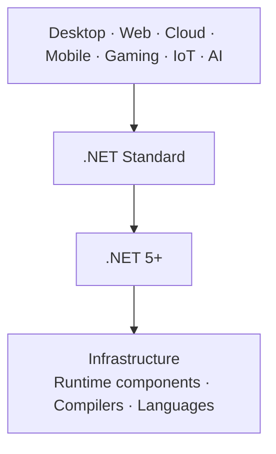
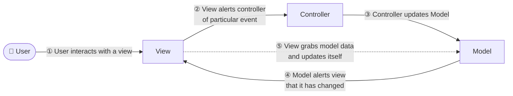
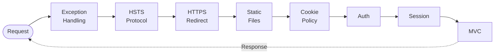
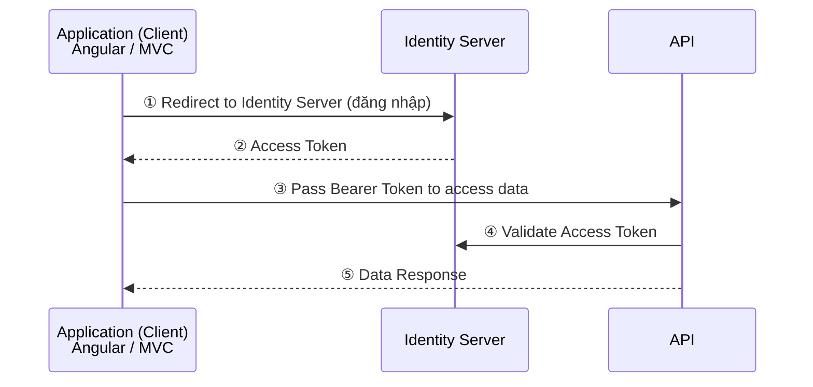
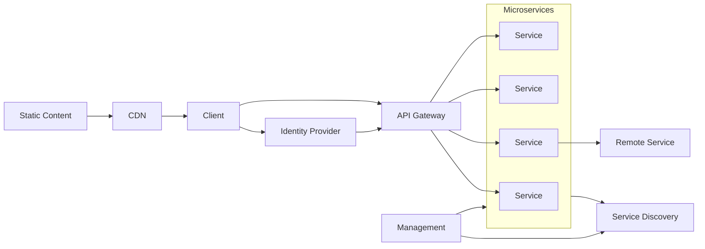
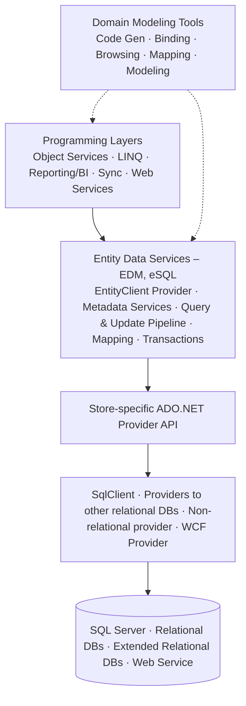

# MVC Application & Integrate with IdentityServer

> Tài liệu tổng hợp từ bài giảng *#14: MVC Application and Integrate with IS4* (TEDU).
> Liên quan: [Clean Architecture.md](Clean%20Architecture.md) · [Docker Infrastructure Setup.md](Docker%20Infrastructure%20Setup.md) · [Work Breakdown Structure.md](../Work%20Breakdown%20Structure.md) (5.4, 5.6, 5.8)

## Mục lục

1. [.NET – A unified platform](#1-net--a-unified-platform)
2. [Roadmap các phiên bản .NET](#2-roadmap-các-phiên-bản-net)
3. [Mô hình MVC](#3-mô-hình-mvc)
4. [Request Pipeline (Middleware)](#4-request-pipeline-middleware)
5. [Identity Server Flow](#5-identity-server-flow)
6. [Microservices](#6-microservices)
7. [Entity Framework Architecture](#7-entity-framework-architecture)
8. [Áp dụng vào Quiz Project](#8-áp-dụng-vào-quiz-project)
9. [Tài liệu tham khảo](#9-tài-liệu-tham-khảo)

---

## 1. .NET – A unified platform

Từ **.NET 5**, Microsoft hợp nhất .NET Framework, .NET Core và Xamarin/Mono thành **một nền tảng duy nhất** để xây dựng mọi loại ứng dụng.

| Loại ứng dụng | Công nghệ |
|---|---|
| **Desktop** | WPF, Windows Forms, UWP |
| **Web** | ASP.NET (Core) |
| **Cloud** | Azure |
| **Mobile** | Xamarin (nay là **.NET MAUI**) |
| **Gaming** | Unity |
| **IoT** | ARM32, ARM64 |
| **AI** | ML.NET, .NET for Apache Spark |



**Công cụ phát triển:** Visual Studio, Visual Studio for Mac, Visual Studio Code, Command Line Interface (`dotnet` CLI).

> Visual Studio for Mac đã bị Microsoft ngừng hỗ trợ từ 31/08/2024. Trên Mac nên dùng **VS Code + C# Dev Kit** hoặc JetBrains Rider.

## 2. Roadmap các phiên bản .NET

| Thời gian | Phiên bản | Loại |
|---|---|---|
| 07/2019 | .NET Core 3.0 | RC |
| 09/2019 | .NET Core 3.0 | GA |
| 11/2019 | .NET Core 3.1 | **LTS** |
| 11/2020 | .NET 5.0 | GA |
| 11/2021 | .NET 6.0 | **LTS** |
| 11/2022 | .NET 7.0 | GA (STS) |
| 11/2023 | .NET 8.0 | **LTS** |
| 11/2024 | .NET 9.0 | STS |
| 11/2025 | .NET 10.0 | **LTS** |

- **Mỗi năm một bản chính**, phát hành vào tháng 11.
- **Bản số chẵn là LTS** (Long Term Support, hỗ trợ 3 năm). Bản số lẻ là **STS** (Standard Term Support), thời gian hỗ trợ ngắn hơn.
- Lịch phát hành **có thể dự đoán trước**, các bản minor chỉ ra khi cần.

> Bảng gốc trong slide dừng ở .NET 8. Hai dòng .NET 9 và .NET 10 là mình bổ sung. Máy bạn đang dùng **.NET 10 SDK**, bản LTS mới nhất.

## 3. Mô hình MVC

**MVC (Model – View – Controller)** tách ứng dụng thành 3 thành phần:

| Thành phần | Vai trò |
|---|---|
| **Model** | Dữ liệu và business logic |
| **View** | Giao diện hiển thị cho người dùng |
| **Controller** | Nhận tương tác, điều phối giữa View và Model |

Luồng xử lý trong slide:



> Sơ đồ trên là MVC "cổ điển" (dùng nhiều trong desktop app). Trong **ASP.NET Core MVC**, luồng thực tế là: **Request → Routing → Controller → (gọi Application/Model) → trả Model cho View → View render HTML → Response**. View không tự lắng nghe thay đổi của Model.

```csharp
public class ExamsController : Controller
{
    private readonly IExamService _examService;
    public ExamsController(IExamService examService) => _examService = examService;

    public async Task<IActionResult> Index()
    {
        var exams = await _examService.GetAllAsync();   // Model
        return View(exams);                             // View: Views/Exams/Index.cshtml
    }
}
```

## 4. Request Pipeline (Middleware)

Mỗi request đi qua một **chuỗi middleware** theo thứ tự đăng ký. Response đi **ngược lại** qua chính chuỗi đó.



| Middleware | Vai trò |
|---|---|
| **Exception Handling** | Bắt lỗi toàn cục, hiển thị trang lỗi. Đặt **đầu tiên** để bắt lỗi của mọi middleware phía sau |
| **HSTS Protocol** | Gửi header `Strict-Transport-Security`, buộc trình duyệt luôn dùng HTTPS |
| **HTTPS Redirect** | Chuyển hướng HTTP sang HTTPS |
| **Static Files** | Trả file tĩnh (css, js, ảnh) và **kết thúc pipeline sớm**, không đi tiếp xuống MVC |
| **Cookie Policy** | Áp dụng chính sách cookie (GDPR consent, SameSite…) |
| **Auth** | Authentication (xác định người dùng là ai), sau đó Authorization (người dùng có quyền không) |
| **Session** | Quản lý session |
| **MVC** | Routing tới Controller/Action, render View |

```csharp
var app = builder.Build();

if (!app.Environment.IsDevelopment())
{
    app.UseExceptionHandler("/Home/Error");
    app.UseHsts();
}
app.UseHttpsRedirection();
app.UseStaticFiles();
app.UseCookiePolicy();
app.UseRouting();
app.UseAuthentication();   // phải đứng trước UseAuthorization
app.UseAuthorization();
app.UseSession();
app.MapControllerRoute("default", "{controller=Home}/{action=Index}/{id?}");

app.Run();
```

> **Thứ tự middleware rất quan trọng.** Ví dụ: đặt `UseAuthorization()` trước `UseAuthentication()` thì người dùng luôn bị coi là chưa đăng nhập.

## 5. Identity Server Flow

**IdentityServer** là server xác thực tập trung, hiện thực chuẩn **OpenID Connect** và **OAuth 2.0**. Các client (Angular, MVC, Mobile…) không tự quản lý đăng nhập mà **ủy quyền** cho Identity Server.



| Bước | Mô tả |
|---|---|
| ① | Client chuyển hướng người dùng sang trang đăng nhập của Identity Server |
| ② | Đăng nhập thành công, Identity Server trả về **Access Token** (JWT) |
| ③ | Client gọi API, gửi kèm header `Authorization: Bearer <token>` |
| ④ | API kiểm tra token: chữ ký, issuer, audience, thời hạn. Thường API chỉ tải **public key** từ Identity Server một lần rồi tự kiểm tra, không gọi lại mỗi request |
| ⑤ | Token hợp lệ thì API trả dữ liệu |

**Cấu hình MVC Client (OpenID Connect + Cookie):**

```csharp
builder.Services.AddAuthentication(options =>
{
    options.DefaultScheme = "Cookies";
    options.DefaultChallengeScheme = "oidc";
})
.AddCookie("Cookies")
.AddOpenIdConnect("oidc", options =>
{
    options.Authority = "https://localhost:5001";   // Identity Server
    options.ClientId = "quiz_admin_mvc";
    options.ClientSecret = "secret";
    options.ResponseType = "code";                  // Authorization Code flow
    options.Scope.Add("quiz_api");
    options.SaveTokens = true;                      // lưu access token để gọi API
});
```

**Cấu hình API (validate Bearer Token):**

```csharp
builder.Services.AddAuthentication("Bearer")
    .AddJwtBearer("Bearer", options =>
    {
        options.Authority = "https://localhost:5001";
        options.Audience = "quiz_api";
    });
```

> - Với SPA như Angular, nên dùng **Authorization Code + PKCE**, không dùng Implicit flow (đã lỗi thời).
> - **IdentityServer4** đã ngừng hỗ trợ từ 12/2022. Bản kế nhiệm là **Duende IdentityServer** (miễn phí cho dự án học tập và doanh nghiệp nhỏ). Có thể thay bằng **OpenIddict** (mã nguồn mở).

## 6. Microservices



| Thành phần | Vai trò |
|---|---|
| **Client** | Web, Mobile, Desktop |
| **Identity Provider** | Xác thực tập trung, cấp token (ví dụ IdentityServer) |
| **API Gateway** | Cổng vào duy nhất: routing, xác thực token, rate limiting, gộp response (ví dụ **Ocelot**, **YARP**) |
| **Microservices** | Các service nhỏ, độc lập. Mỗi service có database riêng, deploy riêng |
| **Remote Service** | Dịch vụ bên ngoài mà service gọi tới |
| **Management** | Quản lý, điều phối service (orchestration, ví dụ Kubernetes) |
| **Service Discovery** | Giúp service tìm địa chỉ của nhau một cách động (ví dụ Consul) |
| **Static Content / CDN** | File tĩnh được phân phối qua CDN để tải nhanh |

**Monolith và Microservices:**

| | Monolith | Microservices |
|---|---|---|
| Triển khai | Một khối duy nhất | Từng service độc lập |
| Scale | Scale toàn bộ | Scale riêng service cần thiết |
| Công nghệ | Một stack | Mỗi service có thể dùng stack khác |
| Độ phức tạp | Đơn giản lúc đầu | Phức tạp hơn (network, giám sát, nhất quán dữ liệu) |

## 7. Entity Framework Architecture

Sơ đồ trong slide là kiến trúc của **Entity Framework "cổ điển"** (EF 4–6 trên .NET Framework):



| Tầng | Vai trò |
|---|---|
| **Programming Layers / Object Services** | Làm việc với dữ liệu dưới dạng object, truy vấn bằng LINQ |
| **Entity Data Services (EDM, eSQL)** | Entity Data Model ánh xạ object ↔ bảng; Query & Update Pipeline chuyển truy vấn thành SQL; quản lý Mapping, Metadata, Transactions |
| **ADO.NET Provider API** | Giao tiếp với database qua connection, command, datareader |
| **Providers** | Driver cho từng loại database: SqlClient (SQL Server), provider cho DB quan hệ khác… |
| **Domain Modeling Tools** | Công cụ thiết kế model, sinh code, mapping |

**EF Core** (dùng trong .NET hiện đại) đơn giản hơn nhiều:

| Thành phần EF Core | Vai trò |
|---|---|
| `DbContext` | Phiên làm việc với database, tương đương *Unit of Work* |
| `DbSet<T>` | Tập entity, tương đương *Repository* cho một bảng |
| Change Tracker | Theo dõi thay đổi của entity để sinh câu lệnh `INSERT` / `UPDATE` / `DELETE` khi gọi `SaveChanges()` |
| LINQ Provider | Dịch LINQ thành SQL |
| Database Provider | SQL Server, PostgreSQL, SQLite, MySQL… |
| Migrations | Quản lý thay đổi schema bằng code |

## 8. Áp dụng vào Quiz Project

> Phần này là gợi ý áp dụng, không có trong slide gốc.

| Kiến thức | Áp dụng trong Quiz Project |
|---|---|
| **Identity Server** | `src/Identity/Identity.API`: cấp token cho Admin UI, Portal UI, Mobile (WBS 5.4) |
| **EF Core + SQL Server** | Identity Server lưu user, client, scope trong **SQL Server** (container `sqlserver`) |
| **MVC + OpenID Connect** | Admin UI / Portal UI đăng nhập qua Identity Server, rồi gọi API bằng access token (WBS 5.6.3, 5.8.3) |
| **JWT Bearer** | `Examination.API` validate token trước khi trả dữ liệu (WBS 5.5.2, 5.7.2) |
| **Microservices** | Identity và Examination là 2 service độc lập, mỗi service có database riêng (SQL Server / MongoDB). Sau này có thể thêm API Gateway |

## 9. Tài liệu tham khảo

- https://learn.microsoft.com/aspnet/core/mvc/overview
- https://learn.microsoft.com/aspnet/core/fundamentals/middleware/
- https://dotnet.microsoft.com/platform/support/policy/dotnet-core
- https://docs.duendesoftware.com/identityserver/
- https://learn.microsoft.com/dotnet/architecture/microservices/
- https://learn.microsoft.com/ef/core/
