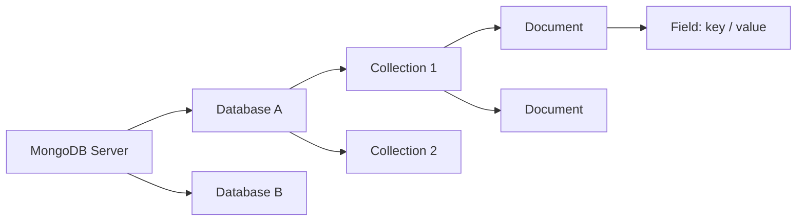
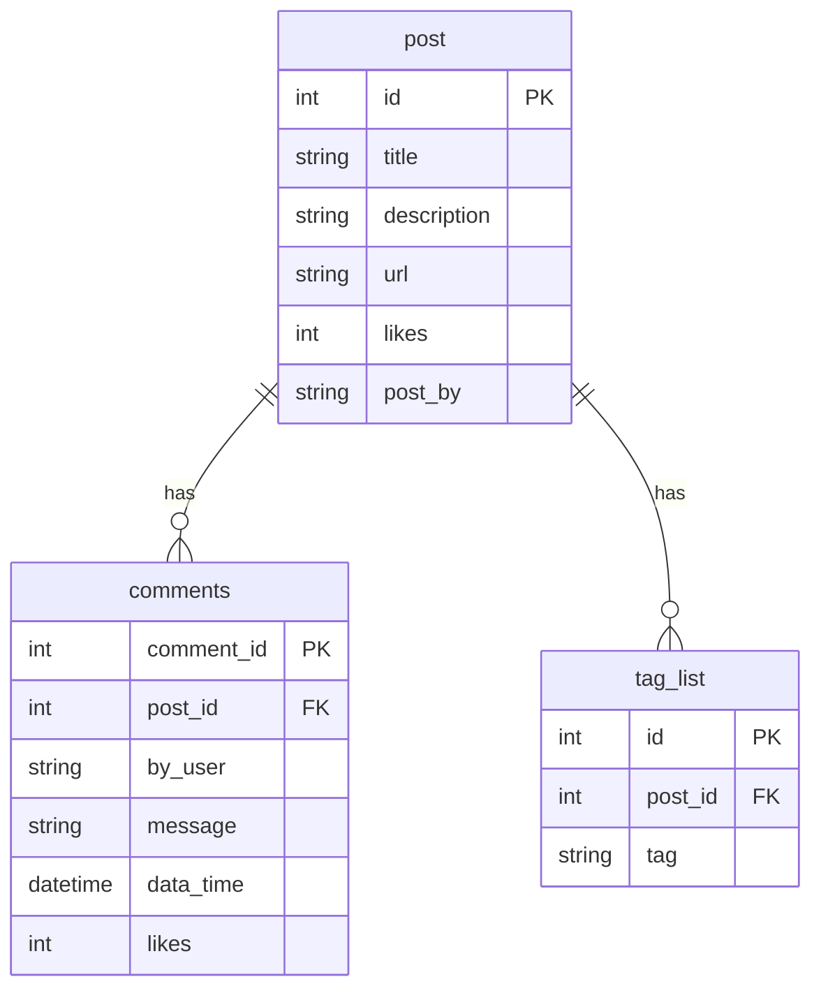

# MongoDB Introduction

> Tài liệu tổng hợp kiến thức MongoDB, hệ thống hóa từ bài giảng *#7: MongoDB Introduction* (TEDU).
> Liên quan: [Tactical Domain Driven Design.md](Tactical%20Domain%20Driven%20Design.md) (Aggregate & Repository).

## Mục lục

1. [Giới thiệu](#1-giới-thiệu)
2. [Các khái niệm cơ bản](#2-các-khái-niệm-cơ-bản)
3. [So sánh với RDBMS](#3-so-sánh-với-rdbms)
4. [Ví dụ Document](#4-ví-dụ-document)
5. [Ưu điểm so với RDBMS](#5-ưu-điểm-so-với-rdbms)
6. [Hiệu năng MongoDB và RDBMS](#6-hiệu-năng-mongodb-và-rdbms)
7. [Nguyên tắc thiết kế schema](#7-nguyên-tắc-thiết-kế-schema)
8. [Ví dụ chuyển từ RDBMS sang MongoDB](#8-ví-dụ-chuyển-từ-rdbms-sang-mongodb)
9. [Kiểu dữ liệu](#9-kiểu-dữ-liệu)
10. [Áp dụng vào Quiz Project](#10-áp-dụng-vào-quiz-project)
11. [Tài liệu tham khảo](#11-tài-liệu-tham-khảo)

---

## 1. Giới thiệu

- Trang chủ: https://www.mongodb.com/
- MongoDB là hệ quản trị cơ sở dữ liệu **hướng tài liệu (document-based)**, thuộc nhóm **NoSQL**, có **khả năng mở rộng cao** và **linh hoạt**.
- Được viết bằng **C++**.
- Đặc điểm: **đa nền tảng**, **tốc độ cao**, **dễ mở rộng** (scale).

## 2. Các khái niệm cơ bản



| Khái niệm | Mô tả |
|---|---|
| **MongoDB Server** | Chứa các database. Một server có thể chứa **nhiều database** |
| **Database** | Đơn vị chứa các collection, tương đương một database trong SQL |
| **Collection** | Nhóm các document, tương đương **table** trong RDBMS. Linh hoạt vì **schema-less**: các document không cần có cùng số lượng field |
| **Document** | Tập hợp các cặp **key/value**, có **dynamic schema**, tương đương **row** trong RDBMS |

> Slide ghi Database là *"same with table in SQL"*. Chính xác hơn: **Database tương đương database**, còn **Collection mới tương đương table** (xem bảng so sánh bên dưới).

## 3. So sánh với RDBMS

| RDBMS | MongoDB |
|---|---|
| Database | Database |
| Table | Collection |
| Tuple / Row | Document |
| Column | Field |
| Table Join | Embedded Documents |
| Primary Key | Primary Key (mặc định là `_id` do MongoDB tự tạo) |

## 4. Ví dụ Document

```javascript
{
  _id: ObjectId("7df78ad8902c"),
  title: "MongoDB Overview",
  description: "MongoDB is no sql database",
  by: "tutorials point",
  url: "http://www.tutorialspoint.com",
  tags: ["mongodb", "database", "NoSQL"],        // Array
  likes: 100,
  comments: [                                   // Embedded documents
    {
      user: "user1",
      message: "My first comment",
      dateCreated: new Date(2011, 1, 20, 2, 15),
      like: 0
    },
    {
      user: "user2",
      message: "My second comments",
      dateCreated: new Date(2011, 1, 25, 7, 45),
      like: 5
    }
  ]
}
```

## 5. Ưu điểm so với RDBMS

| Ưu điểm | Giải thích |
|---|---|
| **Schema-less** | Một collection có thể chứa các document khác nhau |
| **Linh hoạt cấu trúc** | Số lượng field, nội dung và kích thước của các document có thể khác nhau |
| **Cấu trúc object rõ ràng** | Một object được lưu trọn vẹn trong một document |
| **Không có join phức tạp** | Dữ liệu liên quan được nhúng (embed) ngay trong document |
| **Deep query** | Hỗ trợ truy vấn động mạnh mẽ, truy vấn sâu vào field lồng nhau và mảng |
| **Dễ scale** | Hỗ trợ scale ngang (sharding) và replication |
| **Truy cập nhanh** | Dùng bộ nhớ trong (RAM) để lưu *working set* (dữ liệu thường dùng) |

## 6. Hiệu năng MongoDB và RDBMS

- RDBMS dùng **table** để lưu trữ, MongoDB dùng **collection**.
- RDBMS có nhiều **schema**, mỗi schema chứa các table. MongoDB lưu dữ liệu dưới dạng **BSON** (Binary JSON, định dạng giống JSON).
- Slide nêu: *"MongoDB is almost 100 times faster than traditional database systems."*

> **Lưu ý:** con số "nhanh gấp 100 lần" chỉ đúng trong một số kịch bản cụ thể, ví dụ đọc/ghi document đơn lẻ, dữ liệu đã embed, không cần join. Với truy vấn quan hệ phức tạp hoặc giao dịch nhiều bảng, RDBMS vẫn có thể tốt hơn. Nên chọn database theo **mô hình dữ liệu và use case**, không chỉ theo tốc độ.

## 7. Nguyên tắc thiết kế schema

| Nguyên tắc | Ý nghĩa |
|---|---|
| **Gộp các document nếu thường dùng cùng nhau** | Embed dữ liệu đọc cùng lúc vào một document, tránh truy vấn nhiều lần |
| **Ưu tiên lưu trùng lặp hơn là tính toán lại** | Bộ nhớ rẻ hơn CPU. Chấp nhận duplicate data để đọc nhanh |
| **Join khi ghi thay vì khi đọc** | Chuẩn bị sẵn dữ liệu đã gộp lúc ghi, để lúc đọc chỉ cần lấy ra |
| **Tối ưu schema cho các use case dùng nhiều nhất** | Thiết kế theo cách dữ liệu được truy vấn, không theo chuẩn hóa |
| **Không đưa aggregate phức tạp vào schema** | Tránh document quá lớn, lồng quá sâu, khó cập nhật |

## 8. Ví dụ chuyển từ RDBMS sang MongoDB

**RDBMS:** cần 3 bảng và join khi đọc.



**MongoDB:** chỉ cần 1 document, `tags` và `comments` được nhúng trực tiếp.

```javascript
{
  _id: POST_ID,
  title: TITLE_OF_POST,
  description: POST_DESCRIPTION,
  by: POST_BY,
  url: URL_OF_POST,
  tags: [TAG1, TAG2, TAG3],
  likes: TOTAL_LIKES,
  comments: [
    { user: "COMMENT_BY", message: TEXT, dateCreated: DATE_TIME, like: LIKES },
    { user: "COMMENT_BY", message: TEXT, dateCreated: DATE_TIME, like: LIKES }
  ]
}
```

## 9. Kiểu dữ liệu

| Kiểu | Mô tả |
|---|---|
| **String** | Chuỗi, phải là UTF-8 hợp lệ |
| **Integer** | Số nguyên 32-bit hoặc 64-bit |
| **Boolean** | `true` / `false` |
| **Double** | Số thực dấu phẩy động |
| **Min / Max keys** | Giá trị đặc biệt, luôn nhỏ nhất / lớn nhất khi so sánh với các giá trị BSON khác |
| **Arrays** | Mảng / danh sách giá trị |
| **Timestamp** | Mốc thời gian, chủ yếu dùng nội bộ (replication) |
| **Object** | Embedded document |
| **Date** | Ngày giờ (Unix time, tính bằng mili giây) |
| **Object ID** | ID 12 byte, mặc định cho `_id` |
| **Regular expression** | Biểu thức chính quy |

> Slide ghi *"DoubleMin/ Max keys"*, thực chất đây là hai kiểu riêng: **Double** và **Min/Max keys**.

## 10. Áp dụng vào Quiz Project

> Phần này là gợi ý áp dụng, không có trong slide gốc.

MongoDB rất hợp với DDD: **một Aggregate tương ứng một Document**, **một Aggregate Root tương ứng một Collection**. Aggregate được lưu và tải "as a whole", đúng với cách MongoDB lưu document.

| Collection | Nội dung |
|---|---|
| `Questions` | Mỗi document là một `Question`, nhúng danh sách `answers` |
| `Exams` | Mỗi document là một `Exam`, chứa danh sách **ID** câu hỏi (vì `Question` là aggregate riêng) |
| `ExamResults` | Mỗi document là kết quả một lượt thi, nhúng `userAnswers` |

```javascript
// Collection: Questions
{
  _id: "6f1c...",
  content: "C# là ngôn ngữ do công ty nào phát triển?",
  questionType: "SingleSelection",
  level: "Easy",
  categoryId: "a12b...",
  answers: [
    { id: "1", content: "Microsoft", isCorrect: true },
    { id: "2", content: "Google",    isCorrect: false }
  ],
  createdDate: ISODate("2026-10-19T00:00:00Z")
}
```

Kết nối bằng **MongoDB C# Driver** (`dotnet add package MongoDB.Driver`):

```csharp
var client = new MongoClient("mongodb://localhost:27017");
var database = client.GetDatabase("QuizDb");
var questions = database.GetCollection<Question>("Questions");

// Persistence-oriented repository: lưu cả aggregate
await questions.ReplaceOneAsync(q => q.Id == question.Id, question,
    new ReplaceOptions { IsUpsert = true });

var item = await questions.Find(q => q.Id == id).FirstOrDefaultAsync();
```

## 11. Tài liệu tham khảo

- https://www.mongodb.com/
- https://www.mongodb.com/docs/manual/
- https://www.mongodb.com/docs/drivers/csharp/current/
