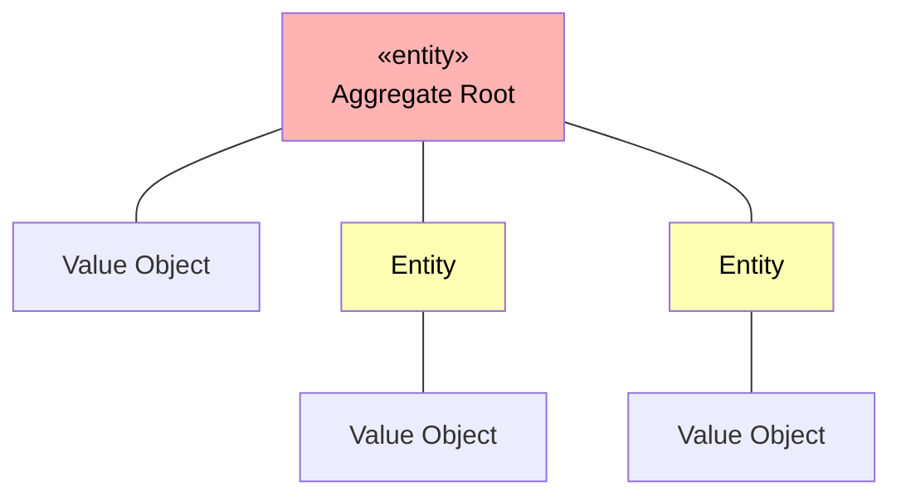
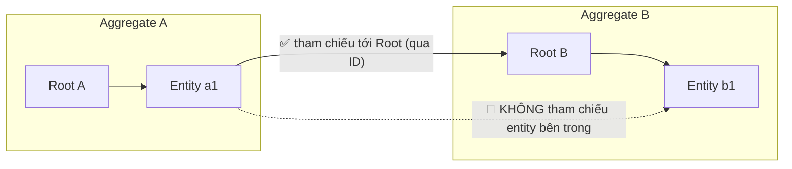
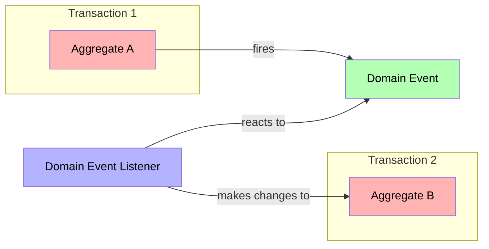
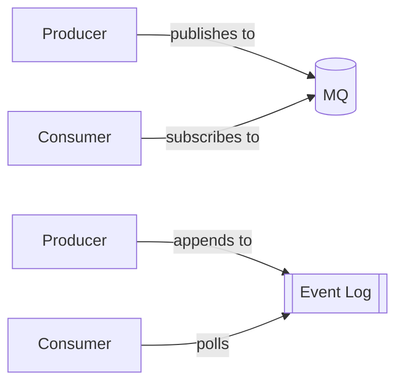
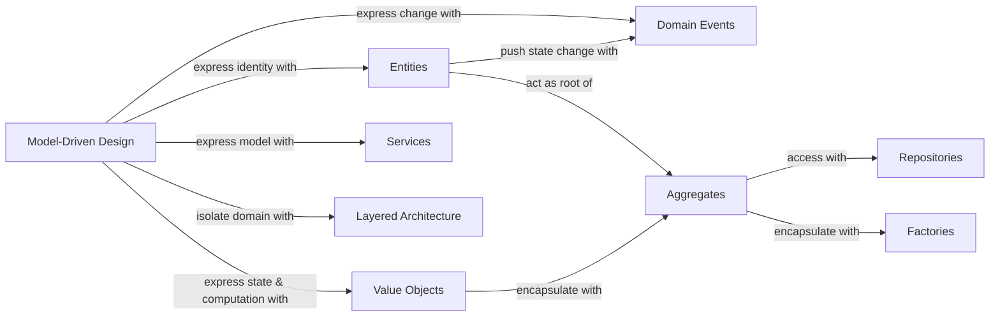

# Tactical Domain-Driven Design

> Tài liệu tổng hợp kiến thức **Tactical DDD**, hệ thống hóa từ bài giảng *#6: Tactical Domain Driven Design* (TEDU).
> Phần Strategic DDD (Domain, Subdomain, Ubiquitous Language, Bounded Context, Context Map) xem tại [Domain Driven Design.md](Domain%20Driven%20Design.md).

## Mục lục

1. [Strategic vs Tactical](#1-strategic-vs-tactical)
2. [Value Object](#2-value-object)
3. [Entity](#3-entity)
4. [Entity hay Value Object?](#4-entity-hay-value-object)
5. [Aggregate](#5-aggregate)
6. [Domain Events](#6-domain-events)
7. [Distributing Domain Events](#7-distributing-domain-events)
8. [Repositories](#8-repositories)
9. [Domain Services](#9-domain-services)
10. [Factories](#10-factories)
11. [Modules](#11-modules)
12. [Tóm tắt](#12-tóm-tắt)
13. [Áp dụng vào Quiz Project](#13-áp-dụng-vào-quiz-project)
14. [Tài liệu tham khảo](#14-tài-liệu-tham-khảo)

---

## 1. Strategic vs Tactical

| Strategic design | Tactical patterns |
|---|---|
| Ubiquitous Language, Domain, Sub-domain, Core domain, Generic Subdomain, Domain model, Context, Bounded Context, Context Map | Entities, Value Objects, Aggregates, Events, Repositories, Services, Factories, Modules, Layers, Dependency Injection |
| Trả lời câu hỏi: **chia bài toán thế nào, ranh giới ở đâu?** | Trả lời câu hỏi: **hiện thực model trong code thế nào?** |

Trong bản đồ tổng thể DDD, Tactical DDD nằm ở nhóm **Software implementation**: *Model-Driven Design* được diễn đạt qua Entities, Value Objects, Services, Domain Events, và được đóng gói bằng Aggregates, Repositories, Factories trong một *Layered Architecture*.

## 2. Value Object

- Là đối tượng mô tả một khía cạnh của domain **không có định danh khái niệm** (no conceptual identity).
- *"Value Objects được tạo ra để biểu diễn những thành phần mà ta chỉ quan tâm **chúng là gì**, không quan tâm **chúng là ai / cái nào**."* (Eric Evans)
- Điều quan trọng của Value Object là **giá trị** của nó. Hai VO có cùng giá trị thì bằng nhau.
- Value Object luôn phải **immutable** (bất biến). Muốn thay đổi thì tạo object mới.
- VO không chỉ chứa dữ liệu mà **còn có thể chứa business logic** (validate, tính toán…).
- Ví dụ: `Money`, `StreetAddress`, `EmailAddress`.

```csharp
// record trong C# so sánh theo giá trị và dễ làm immutable
public record Money
{
    public decimal Amount { get; }
    public string Currency { get; }

    public Money(decimal amount, string currency)
    {
        if (amount < 0) throw new ArgumentException("Amount must be >= 0");
        Amount = amount;
        Currency = currency;
    }

    // Business logic nằm trong Value Object, trả về object mới
    public Money Add(Money other)
    {
        if (other.Currency != Currency) throw new InvalidOperationException("Currency mismatch");
        return new Money(Amount + other.Amount, Currency);
    }
}

new Money(10, "USD") == new Money(10, "USD"); // true
```

## 3. Entity

- *"Nhiều đối tượng không được định nghĩa bởi thuộc tính, mà bởi **sự liên tục và định danh** của chúng."* (Eric Evans)
- Điều quan trọng của Entity là **định danh (identity)**.
- Mỗi Entity có một **ID duy nhất**, được gán khi tạo và **không đổi suốt vòng đời** của entity.
- Hai Entity có cùng thuộc tính nhưng khác ID thì là **hai đối tượng khác nhau**.
- Ví dụ: `Customer`, `Contract`…

```csharp
public abstract class Entity<TId>
{
    public TId Id { get; protected set; }

    public override bool Equals(object? obj) =>
        obj is Entity<TId> other && GetType() == other.GetType() && Id!.Equals(other.Id);

    public override int GetHashCode() => Id!.GetHashCode();
}

public class Customer : Entity<Guid>
{
    public string Name { get; private set; }
    public EmailAddress Email { get; private set; } // Value Object

    public Customer(Guid id, string name, EmailAddress email)
    {
        Id = id; Name = name; Email = email;
    }

    public void ChangeEmail(EmailAddress newEmail) => Email = newEmail; // ID không đổi
}
```

## 4. Entity hay Value Object?

**Quyết định dựa vào ngữ cảnh của domain.** Cùng một khái niệm có thể là Entity ở domain này nhưng là Value Object ở domain khác.

| | Entity | Value Object |
|---|---|---|
| Xác định bởi | ID | Giá trị các thuộc tính |
| So sánh bằng | So sánh ID | So sánh toàn bộ giá trị |
| Tính thay đổi | Mutable (trạng thái thay đổi theo thời gian) | Immutable |
| Vòng đời | Có vòng đời riêng | Phụ thuộc vào Entity chứa nó |

> Ví dụ: `Address` trong hệ thống bán hàng là **Value Object** (chỉ cần biết địa chỉ giao hàng là gì). Nhưng trong hệ thống quản lý bưu điện, nơi từng địa chỉ cần được theo dõi riêng, `Address` có thể là **Entity**.

## 5. Aggregate

- *"AGGREGATE là một cụm các đối tượng liên quan được coi là **một đơn vị** cho mục đích thay đổi dữ liệu. Mỗi aggregate có một **root** và một **boundary**."* (Eric Evans)



### Các ràng buộc của Aggregate

1. Aggregate được **tạo, truy xuất và lưu trữ như một khối thống nhất** (*as a whole*).
2. Aggregate **luôn ở trạng thái nhất quán** (*consistent*). Mọi invariant (quy tắc nghiệp vụ) phải được đảm bảo sau mỗi thay đổi.
3. Aggregate được sở hữu bởi một entity gọi là **Aggregate Root**. ID của root chính là ID của cả aggregate.
4. **Bên ngoài chỉ được tham chiếu tới Aggregate Root**, không được tham chiếu trực tiếp tới entity bên trong aggregate khác. Tốt nhất là tham chiếu bằng ID.



```csharp
public class Order : Entity<Guid>   // Aggregate Root
{
    private readonly List<OrderItem> _items = new();
    public IReadOnlyCollection<OrderItem> Items => _items.AsReadOnly();
    public Guid CustomerId { get; private set; } // tham chiếu aggregate khác bằng ID

    // Mọi thay đổi bên trong aggregate phải đi qua root để giữ invariant
    public void AddItem(Guid productId, int quantity, Money price)
    {
        if (quantity <= 0) throw new ArgumentException("Quantity must be > 0");
        _items.Add(new OrderItem(productId, quantity, price));
    }
}
```

## 6. Domain Events

- *"Bản chất của Domain Event là dùng nó để **ghi nhận những điều có thể kích hoạt thay đổi trạng thái** của ứng dụng."* (Martin Fowler)
- Được đặt tên ở **thì quá khứ**: `OrderPlaced`, `ExamSubmitted`…
- Giúp các aggregate **giao tiếp với nhau mà không phụ thuộc trực tiếp**, mỗi aggregate thay đổi trong **transaction riêng**.



```csharp
public record OrderPlacedEvent(Guid OrderId, Guid CustomerId, DateTime OccurredOn);
```

## 7. Distributing Domain Events

Có hai cách phân phối Domain Event (đặc biệt khi event đi ra ngoài Bounded Context):

| Cách | Luồng | Đặc điểm |
|---|---|---|
| **Message Queue** | Producer **publishes to** → MQ ← **subscribes to** Consumer | MQ đẩy message tới consumer. Ví dụ: RabbitMQ, Azure Service Bus |
| **Event Log** | Producer **appends to** → Event Log ← **polls** Consumer | Consumer chủ động đọc log, có thể đọc lại từ đầu. Ví dụ: Kafka, Event Store |



## 8. Repositories

- Repository là một service cung cấp **interface chung** để truy cập mọi entity và value object **thuộc một aggregate**.
- **Mỗi Aggregate (Root) có một Repository**, không tạo repository cho entity con.
- Các khả năng cơ bản:
  - **Lưu** toàn bộ aggregate vào data storage.
  - **Lấy** toàn bộ aggregate theo ID.
  - **Xóa** toàn bộ aggregate theo ID.
- Hai kiểu repository:

| Kiểu | Mô tả |
|---|---|
| **Collection-oriented** | Giống một collection trong bộ nhớ (`Add`, `Remove`). Thay đổi trên object được theo dõi tự động, không cần gọi `Save` (ví dụ: EF Core với change tracking) |
| **Persistence-oriented** | Phải gọi `Save` / `Update` rõ ràng mỗi khi thay đổi (phù hợp với MongoDB, document DB) |

```csharp
// Interface nằm ở Domain layer, implementation nằm ở Infrastructure layer
public interface IOrderRepository
{
    Task<Order?> GetByIdAsync(Guid id);
    Task SaveAsync(Order order);     // persistence-oriented
    Task DeleteAsync(Guid id);
}
```

## 9. Domain Services

- *"Một số khái niệm của domain không tự nhiên khi mô hình hóa thành object… Service thường được đặt tên theo **hành động** hơn là thực thể, tức là **động từ thay vì danh từ**."* (Eric Evans)
- Dùng khi một nghiệp vụ **không thuộc về một object cụ thể nào**.
- Đặc điểm:
  - **Stateless** (không lưu trạng thái).
  - **Highly cohesive**: chỉ chuyên làm một việc.
  - Chứa **business logic** không phù hợp đặt ở nơi khác.
  - Có thể tương tác với domain service khác và ở mức độ nhất định với repository.
  - Có thể **publish domain events**.
- **Không nhầm lẫn Domain Service với Application Service:**

| | Domain Service | Application Service |
|---|---|---|
| Layer | Domain | Application |
| Chứa | Business logic | Điều phối use case (orchestration), không có business logic |
| Công việc | Tính toán, kiểm tra quy tắc nghiệp vụ liên quan nhiều aggregate | Gọi repository, gọi domain, quản lý transaction, phân quyền, mapping DTO |
| Ví dụ | `MoneyTransferService.Transfer(from, to, amount)` | `PlaceOrderCommandHandler` |

## 10. Factories

- Factory thường được dùng để **tạo Aggregate**.
- Aggregate cung cấp tính đóng gói và ranh giới nhất quán cho một nhóm object, đảm bảo **tính nhất quán nội bộ**.
- Factory hữu ích khi tạo Aggregate mới vì nó **đóng gói toàn bộ kiến thức cần thiết** để tạo Aggregate ở **trạng thái nhất quán, đầy đủ invariant**.

```csharp
public static class OrderFactory
{
    public static Order Create(Guid customerId, IEnumerable<(Guid productId, int qty, Money price)> lines)
    {
        var order = new Order(Guid.NewGuid(), customerId);
        foreach (var l in lines) order.AddItem(l.productId, l.qty, l.price);
        if (!order.Items.Any()) throw new InvalidOperationException("Order must have at least one item");
        return order;
    }
}
```

> Với trường hợp đơn giản, có thể dùng **static factory method** ngay trong Aggregate Root (ví dụ `Order.Create(...)`).

## 11. Modules

- Module trong DDD tương ứng với **package** trong Java và **namespace** trong C#.
- Một module có thể tương ứng với một Bounded Context, nhưng thường **một Bounded Context gồm nhiều module**.
- Các class liên quan chặt chẽ với nhau nên được **nhóm vào cùng một module**.

Ví dụ module `OrderAggregate`:

```text
OrderAggregate/
├── Address.cs            ← Value object
├── IOrderRepository.cs   ← Repo contract / interface
├── Order.cs              ← Aggregate root
├── OrderItem.cs          ← Child entity
└── OrderStatus.cs        ← Enumeration class
```

## 12. Tóm tắt



| Building Block | Câu hỏi then chốt |
|---|---|
| Value Object | Chỉ quan tâm **giá trị**? → immutable, so sánh theo giá trị |
| Entity | Cần **theo dõi định danh** theo thời gian? → có ID cố định |
| Aggregate | Nhóm object nào phải **nhất quán cùng nhau**? → truy cập qua Root |
| Domain Event | **Điều gì đã xảy ra** mà nơi khác cần biết? |
| Repository | **Lưu / lấy** Aggregate thế nào? → mỗi Aggregate một repo |
| Domain Service | Nghiệp vụ **không thuộc object nào**? → stateless, đặt tên bằng động từ |
| Factory | Tạo Aggregate **phức tạp** sao cho hợp lệ? |
| Module | **Tổ chức code** thế nào? → namespace theo khái niệm domain |

## 13. Áp dụng vào Quiz Project

> Phần này là gợi ý áp dụng, không có trong slide gốc.

| Building Block | Gợi ý trong Quiz Project |
|---|---|
| Aggregate Root | `Question`, `Exam`, `ExamResult` |
| Entity con | `Answer` (thuộc `Question`), `UserAnswer` (thuộc `ExamResult`) |
| Value Object | `Level` (Easy/Medium/Hard), `Score`, `Duration` |
| Domain Event | `ExamStartedEvent`, `ExamFinishedEvent` |
| Repository | `IQuestionRepository`, `IExamRepository`, `IExamResultRepository` (persistence-oriented, dùng MongoDB) |
| Domain Service | `ExamScoringService`: chấm điểm bài làm dựa trên `Exam` và `ExamResult` |
| Factory | `Exam.Create(...)`: tạo đề thi ngẫu nhiên từ question bank, đảm bảo đủ số câu |
| Module | `Quiz.Domain/AggregateModels/QuestionAggregate/`, `.../ExamAggregate/`, `.../ExamResultAggregate/` |

Lưu ý: `Exam` nên tham chiếu `Question` **bằng ID** (vì `Question` là aggregate riêng), không nhúng trực tiếp entity `Question` của aggregate khác.

## 14. Tài liệu tham khảo

- https://vaadin.com/learn/tutorials/ddd/tactical_domain_driven_design
- https://patrickdesjardins.com/blog/how-to-work-with-value-object-in-c
- https://bhuwanupadhyay.github.io/posts/domain-driven-design-building-blocks/
