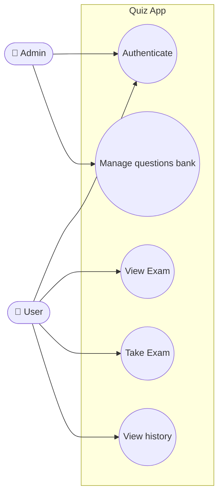
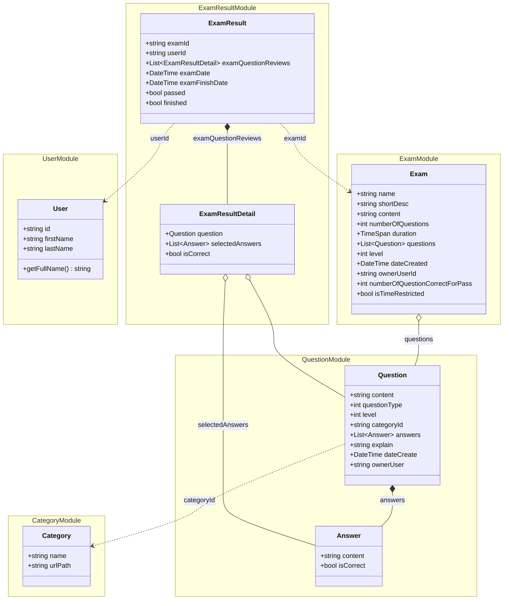

# Use Case & Domain Model

> Tài liệu tổng hợp từ bài giảng *#8: Use Case* (TEDU): use case và domain model của Quiz App.
> Liên quan: [Work Breakdown Structure.md](../Work%20Breakdown%20Structure.md) · [Tactical Domain Driven Design.md](Tactical%20Domain%20Driven%20Design.md) · [MongoDB Introduction.md](MongoDB%20Introduction.md)

## Mục lục

1. [Use Case Diagram](#1-use-case-diagram)
2. [Domain Model (Domain business)](#2-domain-model-domain-business)
3. [Chi tiết từng module](#3-chi-tiết-từng-module)
4. [Phân tích theo Tactical DDD](#4-phân-tích-theo-tactical-ddd)
5. [Ánh xạ Use Case → Domain](#5-ánh-xạ-use-case--domain)
6. [Ghi chú khi triển khai](#6-ghi-chú-khi-triển-khai)

---

## 1. Use Case Diagram

| Actor | Use case | Mô tả |
|---|---|---|
| User, Admin | **Authenticate** | Đăng nhập qua Identity Server |
| Admin | **Manage questions bank** | Thêm, sửa, xóa câu hỏi, đáp án, danh mục; tạo đề thi |
| User | **View Exam** | Xem danh sách và chi tiết đề thi |
| User | **Take Exam** | Làm bài thi, nộp bài, nhận kết quả |
| User | **View history** | Xem lại lịch sử các lần thi và đáp án đã chọn |

## 2. Domain Model (Domain business)

Domain được chia thành 5 module: **Category**, **Question**, **User**, **Exam**, **Exam result**.

> Ký hiệu: `*--` là thành phần nằm trong aggregate (composition), `o--` là bản sao được nhúng vào (embedded copy), `..>` là tham chiếu bằng ID.

## 3. Chi tiết từng module

### 3.1. Category

| Thuộc tính | Kiểu | Ý nghĩa |
|---|---|---|
| `name` | string | Tên danh mục |
| `urlPath` | string | Đường dẫn thân thiện (slug), ví dụ `lap-trinh-csharp` |

### 3.2. Question

| Thuộc tính | Kiểu | Ý nghĩa |
|---|---|---|
| `content` | string | Nội dung câu hỏi |
| `questionType` | int | Loại câu hỏi (ví dụ: chọn một / chọn nhiều đáp án) |
| `level` | int | Độ khó |
| `categoryId` | string | Danh mục chứa câu hỏi |
| `answers` | List\<Answer\> | Danh sách đáp án |
| `explain` | string | Giải thích đáp án đúng |
| `dateCreate` | DateTime | Ngày tạo |
| `ownerUser` | string | Người tạo câu hỏi |

**Answer**

| Thuộc tính | Kiểu | Ý nghĩa |
|---|---|---|
| `content` | string | Nội dung đáp án |
| `isCorrect` | bool | Có phải đáp án đúng không |

### 3.3. User

| Thuộc tính / Phương thức | Kiểu | Ý nghĩa |
|---|---|---|
| `id` | string | ID người dùng (từ Identity) |
| `firstName` | string | Tên |
| `lastName` | string | Họ |
| `getFullName()` | string | Trả về họ tên đầy đủ (business logic nằm trong domain object) |

### 3.4. Exam

| Thuộc tính | Kiểu | Ý nghĩa |
|---|---|---|
| `name` | string | Tên đề thi |
| `shortDesc` | string | Mô tả ngắn |
| `content` | string | Nội dung / hướng dẫn chi tiết |
| `numberOfQuestions` | int | Số lượng câu hỏi |
| `duration` | TimeSpan | Thời gian làm bài |
| `questions` | List\<Question\> | Danh sách câu hỏi của đề |
| `level` | int | Độ khó của đề |
| `dateCreated` | DateTime | Ngày tạo |
| `ownerUserId` | string | Người tạo đề |
| `numberOfQuestionCorrectForPass` | int | Số câu đúng tối thiểu để đạt (pass) |
| `isTimeRestricted` | bool | Có giới hạn thời gian không |

### 3.5. Exam result

**ExamResult**

| Thuộc tính | Kiểu | Ý nghĩa |
|---|---|---|
| `examId` | string | Đề thi đã làm |
| `userId` | string | Người làm bài |
| `examQuestionReviews` | List\<ExamResultDetail\> | Chi tiết từng câu đã làm |
| `examDate` | DateTime | Thời điểm bắt đầu |
| `examFinishDate` | DateTime | Thời điểm kết thúc |
| `passed` | bool | Đạt hay không |
| `finished` | bool | Đã hoàn thành bài thi chưa |

**ExamResultDetail**

| Thuộc tính | Kiểu | Ý nghĩa |
|---|---|---|
| `question` | Question | Câu hỏi (bản sao tại thời điểm thi) |
| `selectedAnswers` | List\<Answer\> | Các đáp án người dùng đã chọn |
| `isCorrect` | bool | Trả lời đúng hay sai |

## 4. Phân tích theo Tactical DDD

> Phần này là phân tích bổ sung, không có trong slide gốc.

| Module | Aggregate Root | Thành phần bên trong | Collection MongoDB |
|---|---|---|---|
| Category | `Category` | – | `Categories` |
| Question | `Question` | `Answer` | `Questions` |
| User | `User` | – | `Users` (hoặc lấy từ Identity) |
| Exam | `Exam` | `Question` (bản sao nhúng) | `Exams` |
| Exam result | `ExamResult` | `ExamResultDetail` | `ExamResults` |

**Vì sao `Exam` và `ExamResultDetail` nhúng nguyên object `Question` thay vì chỉ lưu ID?**

- Cách này áp dụng nguyên tắc MongoDB *"ưu tiên lưu trùng lặp hơn tính toán lại"* và *"join khi ghi thay vì khi đọc"*.
- Nó hoạt động như một **snapshot**: nếu Admin sửa hoặc xóa câu hỏi trong question bank, đề thi và lịch sử thi cũ vẫn giữ nguyên nội dung tại thời điểm tạo hoặc làm bài. Đây là yêu cầu quan trọng cho tính năng **View history**.
- Khi đó, `Question` nhúng bên trong `Exam` chỉ là **dữ liệu sao chép**, không phải là aggregate `Question` gốc. Mọi thay đổi câu hỏi vẫn phải đi qua aggregate `Question` trong module Question.

## 5. Ánh xạ Use Case → Domain

| Use case | Aggregate liên quan | Thao tác chính |
|---|---|---|
| Authenticate | `User` | Xác thực qua Identity API |
| Manage questions bank | `Category`, `Question`, `Exam` | CRUD câu hỏi, đáp án, danh mục; tạo đề thi từ question bank |
| View Exam | `Exam` | Lấy danh sách và chi tiết đề thi |
| Take Exam | `Exam`, `ExamResult` | Tạo `ExamResult` khi bắt đầu, ghi `ExamResultDetail` từng câu, tính `passed` khi kết thúc |
| View history | `ExamResult` | Lấy các `ExamResult` theo `userId` |

## 6. Ghi chú khi triển khai

Một số điểm trong slide nên chỉnh lại khi code, để giữ **Ubiquitous Language** nhất quán:

| Vị trí | Trong slide | Đề xuất |
|---|---|---|
| `Exam` | `ownerUserId` xuất hiện **2 lần** | Giữ một trường `ownerUserId` (nhiều khả năng là lỗi trùng; nếu có ý đồ khác, ví dụ `categoryId`, cần xác nhận lại) |
| `Question` vs `Exam` | `dateCreate` vs `dateCreated` | Thống nhất một tên, ví dụ `DateCreated` |
| `Question` vs `Exam` | `ownerUser` vs `ownerUserId` | Thống nhất `OwnerUserId` |
| Class `answers` | Tên viết thường, số nhiều | Đổi thành `Answer` (tên class số ít, PascalCase theo quy ước C#) |
| `questionType`, `level` | `int` | Dùng `enum` hoặc Enumeration class (ví dụ `QuestionType.SingleSelection`, `Level.Easy`) để rõ nghĩa hơn |
| `Answer` | Không có ID | Nên thêm `Id` để `selectedAnswers` có thể đối chiếu chính xác với đáp án gốc |
