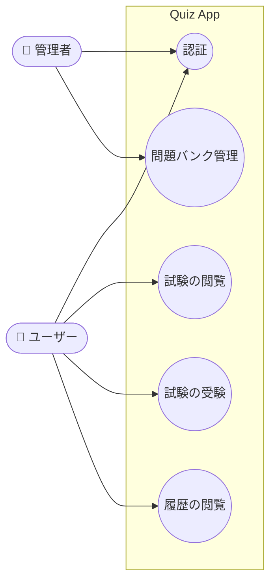
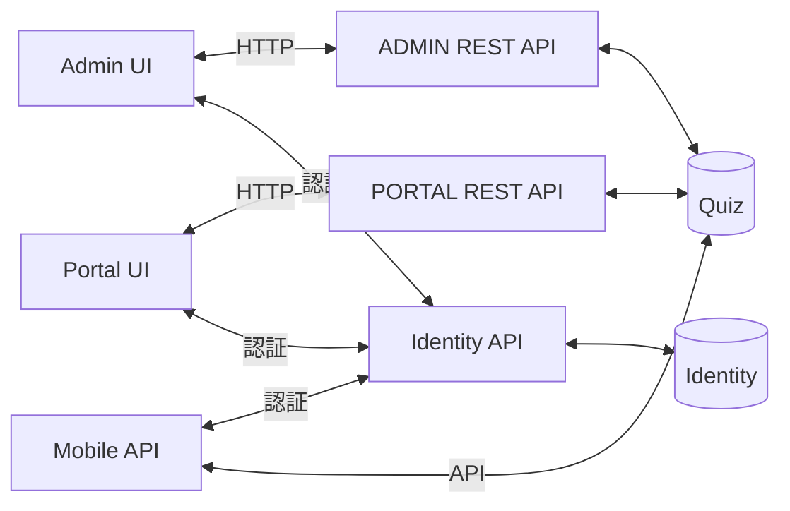

# 作業分解構成図（WBS）

## クイズアプリケーション

- クイズアプリケーションを構築する。
- 問題バンクを管理するための管理ポータルを構築する必要がある。
- ユーザー向けの試験を作成できる機能を構築する必要がある。
- 将来的に新しいアプリケーションを追加していく必要がある。
- ユーザーがログインして試験を受けられるようにしたい。
- ユーザーは試験履歴を閲覧したい。

## ロールと機能

- **管理者（Admin）**
  - 問題管理
  - 試験管理
  - 試験履歴管理
- **ユーザー（User）**
  - 試験一覧の閲覧
  - 試験の受験
  - 試験履歴の閲覧

## ユースケース図

| アクター | ユースケース |
|---|---|
| ユーザー | 認証、試験の閲覧、試験の受験、履歴の閲覧 |
| 管理者 | 認証、問題バンク管理 |

## アーキテクチャ

| コンポーネント | 役割 |
|---|---|
| Admin UI | 管理者向け画面。HTTPでADMIN REST APIと通信し、Identity APIで認証する |
| Portal UI | ユーザー向けポータル画面。HTTPでPORTAL REST APIと通信し、Identity APIで認証する |
| Identity API | 認証基盤。Identityデータベースを使用する |
| ADMIN REST API | 管理機能用のAPI。Quizデータベースにアクセスする |
| PORTAL REST API | ポータル用のAPI。Quizデータベースにアクセスする |
| Mobile API | モバイル用のAPI（将来拡張）。Identity APIで認証し、Quizデータベースにアクセスする |
| Identity（DB） | ユーザー・認証情報を保存するデータベース |
| Quiz（DB） | 問題・試験・結果を保存するデータベース |

## WBS

| WBS | 名称 | ステータス | 担当者 | 開始日 | 終了日 | 備考 |
|---|---|---|---|---|---|---|
| 1 | 準備 |  |  |  |  |  |
| 1.1 | 業務ドメインの決定 |  |  |  |  |  |
| 1.2 | 実装計画の作成 |  |  |  |  |  |
| 1.3 | 対象ユーザーの決定 |  |  |  |  |  |
| 1.4 | 技術選定 |  |  |  |  |  |
| 2 | 要件分析 |  |  |  |  |  |
| 3 | システム設計 |  |  |  |  |  |
| 4.1 | ユースケース図の設計 |  |  |  |  |  |
| 4.2 | 全体アーキテクチャの設計 |  |  |  |  |  |
| 5 | 実装 |  |  |  |  |  |
| 5.1 | リポジトリのセットアップ |  |  |  |  |  |
| 5.2 | デプロイサーバーのセットアップ |  |  |  |  |  |
| 5.3 | 開発環境のセットアップ |  |  |  |  |  |
| 5.4 | IS4による認証プロバイダーの実装 |  |  |  |  |  |
| 5.4.1 | プロジェクト構成の作成 |  |  |  |  |  |
| 5.4.2 | Identity Serverの追加 |  |  |  |  |  |
| 5.4.3 | クライアントの設定 |  |  |  |  |  |
| 5.4.4 | 初期データの投入（Seeding） |  |  |  |  |  |
| 5.5 | 管理者向けDDDによるREST APIの実装 |  |  |  |  |  |
| 5.5.1 | プロジェクト構成の作成 |  |  |  |  |  |
| 5.5.2 | Identityによるログイン |  |  |  |  |  |
| 5.5.3 | Swaggerの追加 |  |  |  |  |  |
| 5.5.4 | ドメインエンティティの実装 |  |  |  |  |  |
| 5.5.5 | MongoDBへの接続 |  |  |  |  |  |
| 5.5.6 | APIバージョニングの追加 |  |  |  |  |  |
| 5.5.7 | アプリケーション層でのCQRSの実装 |  |  |  |  |  |
| 5.5.8 | REST APIの作成 |  |  |  |  |  |
| 5.6 | 管理画面（Admin UI）の実装 |  |  |  |  |  |
| 5.6.1 | プロジェクト構成の作成 |  |  |  |  |  |
| 5.6.2 | バックエンドAPIとの連携 |  |  |  |  |  |
| 5.6.3 | Identityによるログイン |  |  |  |  |  |
| 5.6.4 | 問題管理 |  |  |  |  |  |
| 5.6.5 | 試験管理 |  |  |  |  |  |
| 5.6.6 | 結果管理 |  |  |  |  |  |
| 5.6.7 | ユーザー管理 |  |  |  |  |  |
| 5.7 | ポータル用APIの実装 |  |  |  |  |  |
| 5.7.1 | プロジェクト構成の作成 |  |  |  |  |  |
| 5.7.2 | Identityによる認可 |  |  |  |  |  |
| 5.7.3 | REST API |  |  |  |  |  |
| 5.8 | クイズポータルの実装 |  |  |  |  |  |
| 5.8.1 | プロジェクト構成の作成 |  |  |  |  |  |
| 5.8.2 | バックエンドAPIとの連携 |  |  |  |  |  |
| 5.8.3 | Identityによるログイン |  |  |  |  |  |
| 5.8.4 | 試験一覧 |  |  |  |  |  |
| 5.8.5 | 試験詳細の閲覧 |  |  |  |  |  |
| 5.8.6 | 試験の受験 |  |  |  |  |  |
| 5.8.7 | 結果の閲覧 |  |  |  |  |  |
| 5.8.8 | プロフィール |  |  |  |  |  |
| 5.8.9 | 履歴の閲覧 |  |  |  |  |  |
| 6 | テスト |  |  |  |  |  |
| 7 | デプロイ |  |  |  |  |  |
